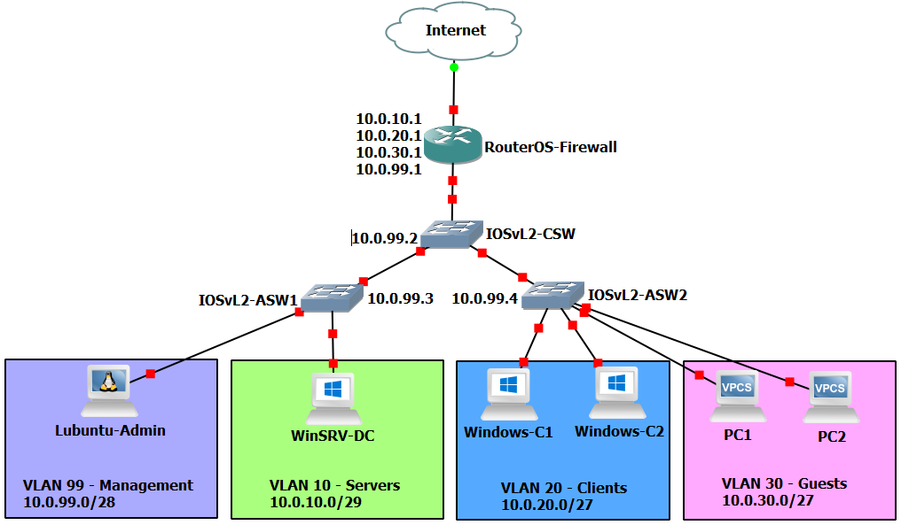

# 🔻تمرین عملی مباحث +Security

## 🔹محیط کار و توپولوژی

    
**GNS3**⬆️

## 🔹هدف

- با **استفاده از** مجازی‌سازی در GNS3 و VMWare Workstation محیطی طراحی کنیم که در 5 مرحله مختلف بخش خوبی از مباحث +Security رو پوشش بدیم.
    
- **هدف** از این سناریو اینه که +Security رو صرفا تئوری نگذرونده باشیم، و کلی قابلیت ریز اما مهمی که داخل دوره‌ها نیست رو یاد گرفت!

## 🔹اقدامات و کانفیگ‌ها

### 🔸اقدامات

#### ▫️مرحله 1 - Layer2 Security

| قابلیت                     |      محل پیاده‌سازی      | دلیل                              |
| -------------------------- | :----------------------: | --------------------------------- |
| Port Security + Sticky MAC |       ASW1 و ASW2        | محدودکردن دستگاه‌های متصل به پورت |
| Unused Port Shutdown       |       هر سه Switch       | کاهش سطح حمله فیزیکی              |
| BPDU Guard                 |     پورت‌های Access      | جلوگیری از اتصال سوئیچ غیرمجاز    |
| Root Guard                 | لینک‌ها و پورت‌های مناسب | محافظت از Root Bridge             |
| DHCP Snooping              |       CSW و ASWها        | مقابله با Rogue DHCP              |
| Dynamic ARP Inspection     |          ASWها           | مقابله با ARP Spoofing            |
| IP Source Guard            |     پورت‌های Access      | جلوگیری از IP Spoofing            |

#### ▫️مرحله 2 - Network Segmentation & Firewall

| قابلیت               | محل پیاده‌سازی | دلیل                                    |
| -------------------- | :------------: | --------------------------------------- |
| VLAN Segmentation    | Cisco Switches | جداسازی بخش‌های سازمان                  |
| Inter-VLAN Filtering |  MikroTik CHR  | کنترل ارتباط بین VLANها                 |
| Stateful Firewall    |  MikroTik CHR  | کنترل ارتباطات بر اساس وضعیت Connection |
| Default Deny         |  MikroTik CHR  | مسدودکردن ارتباطات غیرضروری             |
| Egress Filtering     |  MikroTik CHR  | کنترل ارتباطات خروجی                    |
| Guest Isolation      |    VLAN 30     | جلوگیری از دسترسی Guest به منابع داخلی  |
| NAT                  |  MikroTik CHR  | مدیریت دسترسی اینترنتی                  |

#### ▫️مرحله 3 - Secure Network Management

| قابلیت                     |  محل پیاده‌سازی  | دلیل                                |
| -------------------------- | :--------------: | ----------------------------------- |
| SSH                        | Cisco و MikroTik | مدیریت امن تجهیزات                  |
| AAA و Local Authentication | Cisco و MikroTik | کنترل هویت مدیران                   |
| Management ACL             |   تجهیزات شبکه   | محدودکردن دسترسی مدیریتی به Lubuntu |
| SNMPv3                     |   تجهیزات شبکه   | مانیتورینگ امن                      |
| NTP Authentication         |   تجهیزات شبکه   | اعتماد به منبع زمان                 |
| Centralized Syslog         |     Lubuntu      | جمع‌آوری متمرکز لاگ‌ها              |
| Configuration Backup       |   تجهیزات شبکه   | امکان بازیابی تنظیمات               |

#### ▫️مرحله 4 - Windows & Identity Security

| قابلیت                            |     محل پیاده‌سازی      | دلیل                           |
| --------------------------------- | :---------------------: | ------------------------------ |
| Active Directory                  |     Windows Server      | مدیریت متمرکز هویت             |
| User & Group Management           |     Windows Server      | کنترل دسترسی کاربران           |
| Group Policy                      |     Windows Server      | اعمال سیاست‌های امنیتی         |
| Account Lockout / Password Policy |     Windows Server      | کاهش ریسک دسترسی غیرمجاز       |
| NTFS & Share Permissions          |     Windows Server      | حفاظت از اطلاعات               |
| Windows Defender Firewall         |     Windows Client      | کنترل ارتباطات سیستم           |
| Windows Auditing                  |     Server و Client     | ثبت رویدادهای امنیتی           |
| LAPS                              | Windows Server و Client | مدیریت امن Local Administrator |

#### ▫️مرحله 5 - Security Assessment & Monitoring

| ابزار / قابلیت         |   محل پیاده‌سازی   | دلیل                   |
| ---------------------- | :----------------: | ---------------------- |
| Nmap                   |      Lubuntu       | کشف پورت‌ها و سرویس‌ها |
| Wireshark              |   Lubuntu / GNS3   | تحلیل ترافیک           |
| Vulnerability Scanning | Lubuntu یا VM مجزا | شناسایی آسیب‌پذیری‌ها  |
| Log Analysis           |      Lubuntu       | تحلیل رخدادها          |
| Incident Response      |      کل شبکه       | بررسی و پاسخ به رخداد  |

#### ▫️مرحله 6 - Cryptography, Recovery & Risk

| قابلیت                      |  محل پیاده‌سازی  | دلیل                           |
| --------------------------- | :--------------: | ------------------------------ |
| PKI و Certificates          |  Windows Server  | ایجاد زیرساخت اعتماد           |
| TLS / HTTPS                 | سرویس آزمایشگاهی | حفاظت از ارتباطات              |
| Hashing و Digital Signature |     Lubuntu      | بررسی Integrity و Authenticity |
| Backup & Restore            |  Windows Server  | بازیابی اطلاعات                |
| RPO / RTO                   |  سناریوی سازمان  | تعیین اهداف بازیابی            |
| Risk Assessment             |     کل پروژه     | شناسایی و اولویت‌بندی ریسک‌ها  |

### 🔸کانفیگ‌ها

#### ▫️مرحله 1 - Layer2 Security

#### ▫️مرحله 2 - Network Segmentation & Firewall

#### ▫️مرحله 3 - Secure Network Management

#### ▫️مرحله 4 - Windows & Identity Security

#### ▫️مرحله 5 - Security Assessment & Monitoring

#### ▫️مرحله 6 - Cryptography, Recovery & Risk

## 🔹راستی آزمایی

#### ▫️مرحله 1 - Layer2 Security

>**آزمایش:**
>اتصال MAC غیرمجاز، DHCP Server جعلی، ARP Spoofing و بررسی رفتار Switchها.

#### ▫️مرحله 2 - Network Segmentation & Firewall

>**آزمایش:**
>بررسی اینکه Guest به Server یا Management دسترسی نداشته باشه، Staff فقط به سرویس‌های مجاز دسترسی داشته باشه و Admin امکان مدیریت تجهیزات رو داشته باشه.

#### ▫️مرحله 3 - Secure Network Management

>**آزمایش:**
>تلاش برای مدیریت تجهیزات از VLAN 20 و 30، بررسی لاگ‌های مدیریتی و تست SNMPv3.

#### ▫️مرحله 4 - Windows & Identity Security

>**آزمایش:**
>تلاش برای دسترسی غیرمجاز به Shared Folder، ورود ناموفق، بررسی GPO و تحلیل Event Viewer.

#### ▫️مرحله 5 - Security Assessment & Monitoring

>**آزمایش:**
>شناسایی سرویس‌های غیرضروری، ایجاد چند رویداد آزمایشگاهی، بررسی لاگ‌ها و تهیه گزارش Incident.

#### ▫️مرحله 6 - Cryptography, Recovery & Risk

>**آزمایش:**
>راه‌اندازی HTTPS با Certificate آزمایشگاهی، اعتبارسنجی گواهی، تهیه Backup و بازیابی اطلاعات.

## 🔹مشکل

- **مشکل**م 
    
- **راه‌حل**‌ش 

## 🔹نتیجه

>

